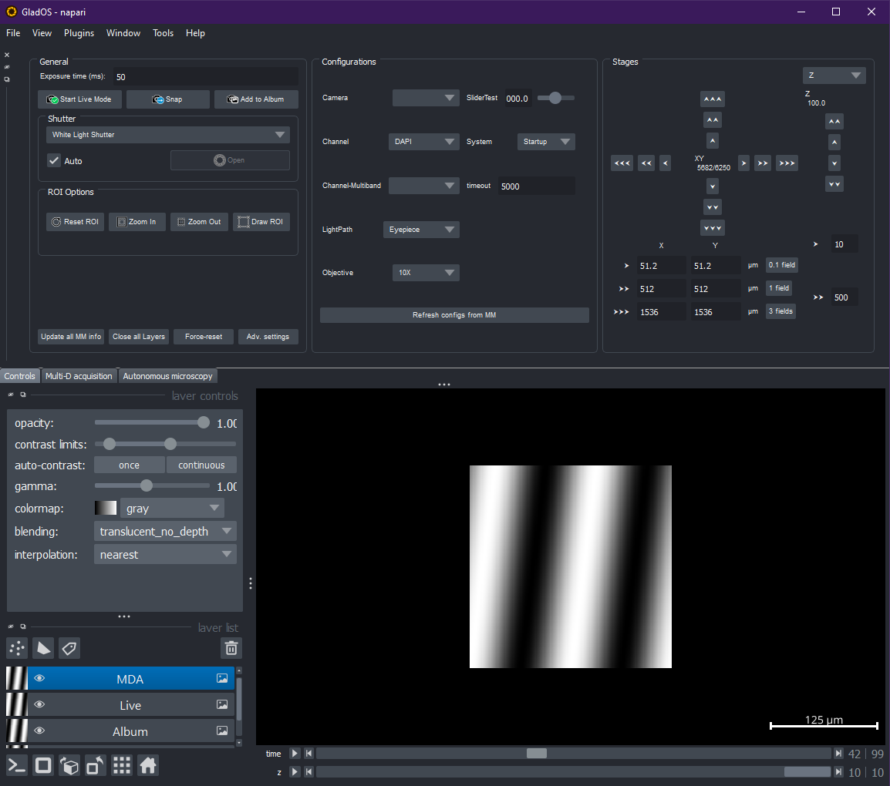

# Glados-pycromanager

Glados-pycromanager is an attempt to (1) create a usable, user-friendly user-interface for Pycromanager (i.e. python-Micromanager) with Napari, and (2) to create easy, user-friendly autonomous microscopy via Pycromanager.  

Created by:  
Dr. Koen J.A. Martens, koenjamartens{at}gmail.com, 2023-2024  
CC BY-NC-SA 4.0 licence

Please contact me if you want to use/extend/etc.




## Installation instructions, user manual

Windows, with [Git](https://git-scm.com/download/win) installed:

```batch
git clone https://github.com/kjamartens/Gladoscopy.git
cd Gladoscopy
install_windows.bat
```

The script installs [uv](https://docs.astral.sh/uv/) if needed, which then sets up Python 3.13 and all dependencies in a `.venv` folder (no conda needed), and offers Start Menu shortcuts. Re-run it after a `git pull` to update. Developers: `make dev` (see [CONTRIBUTING.md](CONTRIBUTING.md)).

Find the user manual with full installation and Micro-Manager setup instructions [here](glados_pycromanager/Documentation/UserManual.md)

## Detailed developer instructions

The Glados-pycromanager codebase is explained [in this document](glados_pycromanager/Documentation/index.html)

### Glados-pycromanager is a work-in-progress!
