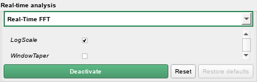
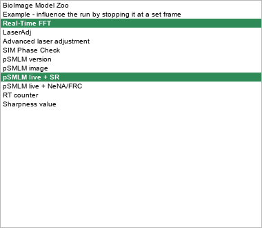
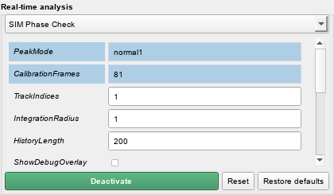
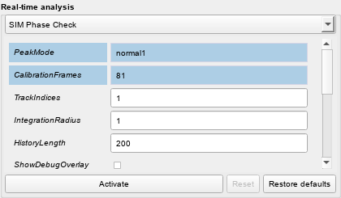

# 2026-10-13 — RT-analysis panel UI (Controls dock)

- RT-analysis section moved out of `MMConfigUI.realTimeAnalysisLayout` into new `GUI/rt_analysis_panel.py` (`RTAnalysisPanel`).
- Removed "Test on current napari image" / "Auto-update on slice change"; **Activate** feeds the shown napari image once when no live/MDA runs.
- One toggle button (Activate / green `ROLE_ACTIVE` Deactivate, polled every 0.5 s), **Reset** (deactivate → re-activate on a 0 ms timer), **Restore defaults** (selected method only).
- Settings persist in `glados_state.json` → `RTAnalysis` (selected method + non-default values only), via new `appdata.save_state_section`; only when `autoSaveLoad` (Nodz dialogs never write). Changed values get `ROLE_MODIFIED` highlight (new theme fields `modified`, `active`).
- Value/Variable/Advanced switch hidden: `utils.layout_init(..., showVariableOptions=False)`.
- Method dropdown is a full-width row above the parameters; parameters scroll, capped at 6 rows.
- Fix: `NapariLayerGroup.remove_all` now removes only layers that are still the group's own objects (deferred cleanup would otherwise delete a Reset's new same-named layers).
- Follow-up: several RT methods can run at once; Activate/Deactivate/Reset act on the method selected in the dropdown. Each run gets its own settings copy -- the shared dict made a second activation retarget the first (the node re-reads its class every frame).
- Tests: 15 new (+2 for multi-method) (`test_rt_analysis_panel.py` + 1 in `test_layer_group.py`), ~9 s; full fast suite 1476 passed in 74 s. Not committed.

## Details

**Errors hit and fixes**
- First render showed BioImageModelZoo's `model_id`/`imageLayerId` under every method: the dropdown was never connected to `utils.layout_changedDropdown` (the old code did that outside `layout_init`). Connected; regression test added.
- Scroll area rendered only ~2 rows: layouts cached its size hint, which depends on the content widget and the dropdown's row height (both restyled after the scroll area). Fixed with an event filter on both (LayoutRequest/StyleChange/FontChange → `updateGeometry()`).

- User report: with one RT analysis running, selecting another method and pressing Activate/Deactivate did not act on it separately. Cause: the panel tracked a single thread, and every thread received the panel's own `currentData` dict. `_rtAnalysisClassName` re-reads `__selectedDropdownEntryRTAnalysis__` per frame, so a second activation would also have retargeted the first run's class. Fix: `_runs` = `{Module.Function: {'thread', 'info'}}` with a per-run copy of that method's keys; buttons follow the dropdown selection; `_onParamEdited` updates existing keys of the running copy, so live edits still apply. Tests: `test_two_methods_run_and_stop_independently`, `test_editing_a_running_method_reaches_only_its_run`; panel and layer-group tests 52 passed in 34 s.

- Dropdown highlights for running methods: green/bold list items (item data roles; needs a plain `QStyledItemDelegate` on the combo, as the default popup delegate ignores them) and a green `ROLE_ACTIVE` border on the closed combo while the selected method runs. Test `test_running_methods_are_highlighted_in_the_dropdown`; panel + theme tests 23 passed in 20 s. The popup itself can't be grabbed offscreen (crashes), so the list render uses a standalone `QListView` on the same model.

**Render (offscreen, real nodes, dock stylesheet)**

**Open items**
- Not clicked through in the running app (activate-on-napari-image with a real node, Reset with a multi-layer node like pSMLM_live).
- Single-image metadata is synthetic (`Axes={'time':0}`, `PixelSize_um` from `hw_pixel_size_um` or layer scale); nodes needing acquisition context (e.g. EndAtFrame) may not do anything useful on a static image.
- Commit on `ui_improvements` awaits the user.
