# 2026-10-13: UI improvements (path history, debug console, config presets)

- Branch `ui_improvements` (created from `main` on request, then rebased on the updated `main`), three commits, not pushed:
  - `174ae92` ux(startup): last-20 history dropdown for the MM path and config file in the start dialog.
  - `37c48ba` fix(launcher): "Glados (debug console)" shortcut now runs `cmd.exe /k "<glados.exe>"`, so the console stays open after a crash or exit.
  - `fc29caa` fix(mmcontrols): config preset dropdowns show the active preset; blank only when no preset matches.
- The one-click launcher (PR #20) **was** already merged on `origin/main`; local `main` was just behind. Fast-forwarded local `main`, no merge needed.
- Start Menu shortcuts were reinstalled (`python -m glados_pycromanager.shortcuts install`) so the existing debug-console entry has the new target.
- Full fast suite: 1438 passed, 15 deselected, ~78 s.
- Second round, also on `ui_improvements`:
  - `e42e0b3`: compact Stages section; offscreen size hint went from 573x370 to 469x262.
  - `4199d2b`: Scripts box hidden by default, with a new Advanced-settings checkbox type.
  - `dabfc26`: "Glados could not start" box gains Show Details (log tail) and Open log file.
  - `2fee862`: Micro-Manager's real start error is shown instead of the ZMQ hint.
  - Full fast suite after this round: 1447 passed, ~62 s.
- Third round:
  - `8bfdae0`: the test suite had overwritten the user's real `glados_state.json` with defaults, wiping the MM path history. A session autouse fixture now redirects `appdirs.user_data_dir`; verified with a write trap over the full suite.
  - `bb69132`: FOV step buttons fill one decimal.
  - `7a99d1b`: Stages redesigned through three rounds of mockups. The user picked "F2b": an XY ring dial with the step table below it, and a separate Z block. A new `ROLE_COMPACT` tightens the spacing. 373x258 px under napari's dark stylesheet.
  - Full fast suite: 1453 passed, ~67 s.
  - `c79300e`: "a tad more margin", especially for the bottom buttons. Compact padding went from 1 to 2 px (buttons +2 px more), and grid spacing from 0 to 2 px (`compact_spacing`). Render went from 373x258 to 411x276. Stage, layout and theme tests: 34 passed, ~21 s. The final image (`img/2026-10-13_stages_dial_final.png`) shows this version.

- Fourth round:
  - `09e88c8`: the Stages-level density now applies to every dock (General, Configurations, RT analysis, MDA, Autonomous microscopy).
    - `build_stylesheet` derives padding and margin as half the stored theme values (`compact_padding`/`compact_margin`), and buttons get `pad+2`.
    - Layout spacing is `compact_spacing` in `sections.py`/`list_editor.py`.
    - `ROLE_COMPACT` is removed.
    - Because the values are derived, existing `glados_state.json` files get the new look.
  - Fast suite: 1453 passed, ~74 s.
  - Rendered Controls and MDA before/after. The Autonomous microscopy dock was not rendered; it uses the same stylesheet.
- Fifth round:
  - The Configurations width is capped at 42 em per block of rows (~420 px).
  - Slider rows: the number field is narrow and the slider stretches.
  - `ResponsiveGrid` stretches the trailing column when every stretched column is capped. Experiment: Qt caps a whole column at its narrowest item's maximum, and otherwise gives the spare space to an unstretched column.
  - Fast suite: 1455 passed, ~81 s. Layout files: 39 passed, ~4 s.
  - Render: 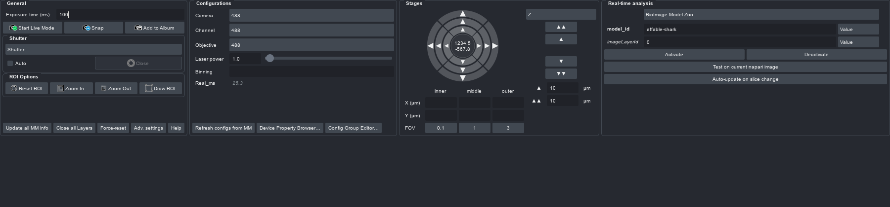
- Sixth round (`6768a9e`): the startup dock height now fits the Controls and MDA tabs.
  - A real `--auto-demo` launch, probed with a runpy launcher, showed the bug: Controls content needed 306 px and the dock asked for 334 (content + 28 px chrome), but the viewport got 281. Qt takes the tabified docks' tab bar out of the `resizeDocks` height. The wrapped "Config Group Editor…" line also wasn't in `sizeHint()`.
  - Fix:
    - `_dockContentHeight` measures with height-for-width.
    - The area is sized for the taller of Controls and MDA (`alsoFit`).
    - `_correctControlsDockHeight` re-measures after layout and adds the deficit.
    - Result: Controls 306 needed / 316 shown; MDA 316 / 316; no scrollbars.
  - MDA made shorter:
    - Two-column `ListEditor` buttons.
    - `MDA_LIST_MIN_ROWS = 3`. This is passed per caller, not changed in the theme, because the stored `LayoutConfig` would keep 5.
    - Z Start/End on one row; the checkbox text is shortened to "Wait for Z to settle".
    - Content height: 341 → 316.
  - Bug found along the way: `configure_table_header` dropped the row-header width because `isVisible()` is False before show, and that clipped "Channel Setting". It now uses `isHidden()` and refreshes on row insert/remove.
  - Probe gotcha: a `runpy` launcher's module-level code re-runs in multiprocessing `spawn` children (the warm RT pool), which wrote stray `--auto-demo*` files into the repo root. They were deleted. Next time, guard the probe with `if __name__ == '__main__'`.
  - Fast suite: 1461 passed, ~52 s.
  - 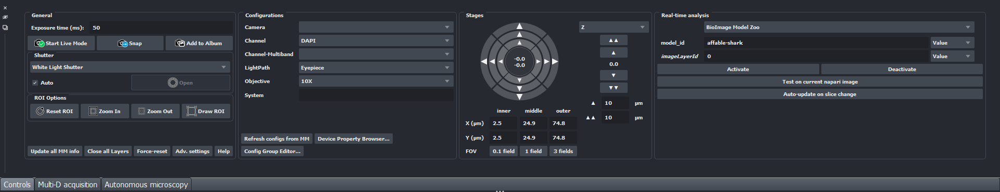
- `3373b54`: the Configurations controls are a third narrower. `CONFIG_BLOCK_MAX_WIDTH_EM` went 42 → 32, so the box went 420 → 320 px and the dropdowns ~296 → 199 px in a real `--auto-demo` launch. Panel tests: 32 passed, ~39 s.
  - 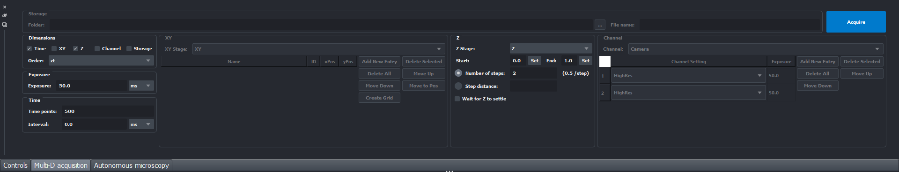

## Details

### Dense docks (all panels)
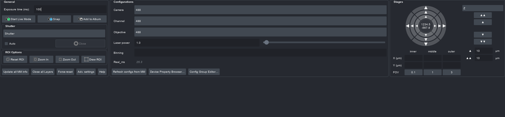
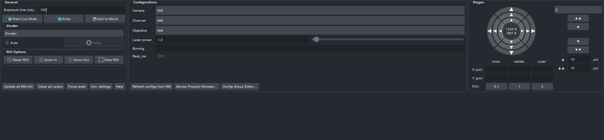
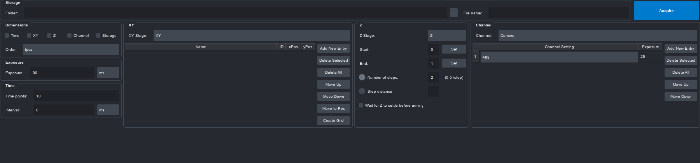
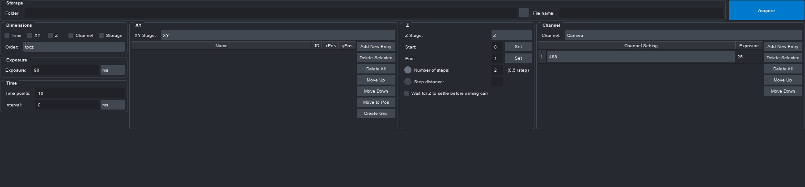

### Start dialog path history
- `MicroManagerConfig.path_history` / `config_path_history` (lists, hidden). `setting()` grew a `default_factory` parameter, since a list cannot be a dataclass default.
- `headless_validation.push_path_history(history, value, limit=20)`: newest first, deduplicated with `normcase(normpath())`, ignores empty values, tolerates non-list history.
- `headlessGUI`: a `QToolButton` (down arrow, `InstantPopup` menu) next to each line edit; disabled when its history is empty. Values are recorded on Start.
- Tests: `tests/test_headless_path_history.py` (with the existing headless-validation tests, 17 passed, ~8 s). The persistence tests still pass (63 passed, ~18 s).
- Offscreen screenshot (needed `import PyQt5.QtWebEngineWidgets` before creating the `QApplication`):

  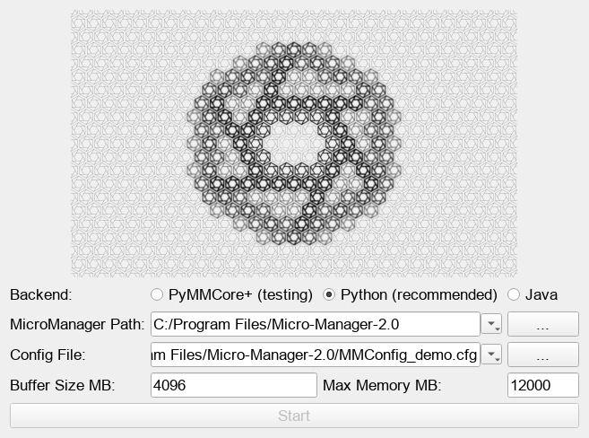

### Debug console stays open
- The shortcuts are written by `glados_pycromanager/shortcuts.py`. The debug spec targeted `glados.exe` directly, so the console closed with the process.
- It now targets `%ComSpec%` with `/k "<glados.exe>"`. The new `ShortcutSpec.launcher` field / `required` property is what `install()` checks exists.
- Tests: `tests/test_launcher.py` updated; launcher plus history tests 38 passed, ~19 s. Not verified by a real crash.

### Config dropdown empty while a preset is active
- Root cause: `addDropDown()` never selected a preset (its `updateValuefromMM` call was commented out). `rebuildConfigLayout()`, which the auto-refresh timer also calls, recreates every dropdown, so they were always blank.
- Fix: `_selectDropDownPreset(config_id, preset)` selects the preset via `findText`, falling back to index 0 (blank). Signals are blocked, so there is no `set_config` write-back and no checkbox tick. Used by `addDropDown` and `updateValuefromMM`.
- Tests: `tests/test_mmconfig_panel.py::TestDropDownShowsActivePreset` (3 tests); panel plus owner-thread files 34 passed, ~5.5 s.

### Compact Stages section
- The problem (seen in the user's screenshot): the box was about 620 px wide and filled the dock height. The XY cross took 5 rows with the step table below it, Z took 8 rows, and the cells and fields stretched.
- The fix keeps the same widgets and wiring. The XY arms are now horizontal rows of buttons, so the cross is 3 rows. Step fields are capped (`_limitFieldWidth`), Z's step fields sit beside its buttons, and everything packs to the left.
- Before and after (offscreen, light style):

  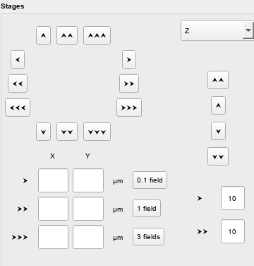 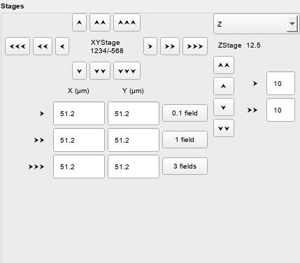

- Test: `test_controls_panel_layout.py::test_stages_section_is_compact`.

### Scripts box hidden by default
- New setting `VisualisationConfig.show_scripts_section` (bool), shown as a checkbox in Advanced settings.
- It first went into `LayoutConfig`, but `test_ui_theme` requires `LayoutConfig` to stay all-hidden, so it was moved.
- The checkbox branch skips the dialog's float/int coercion, which would otherwise store `True` as `1`.

### Startup error box
- "Show Details..." shows the last 400 lines of the console log, which you can select and copy. "Open log file" opens the whole file, and the box loops until OK.
- A test bug along the way: a `QApplication` that wasn't kept referenced was garbage-collected, so the function returned early.
- Showing a `QMessageBox` offscreen segfaults, so the details-expanded screenshot is unshown and its right edge is clipped:

  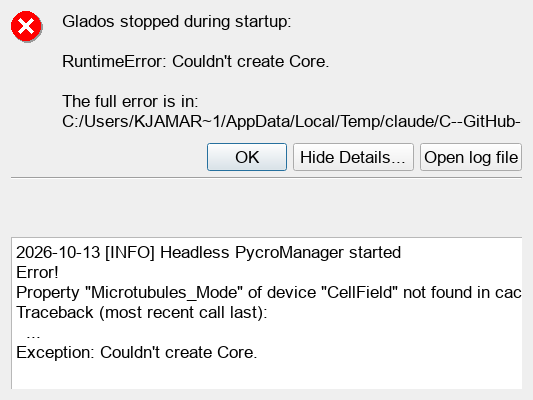

- The real cause: `start_headless()` errors were printed and swallowed. `connect_headless_core` now raises `MicroManagerStartError` with the actual cause. Tests: `tests/test_headless_start_error.py`.

### Stages redesign (dial)
- Round 1 (A/B/C) rejected:

  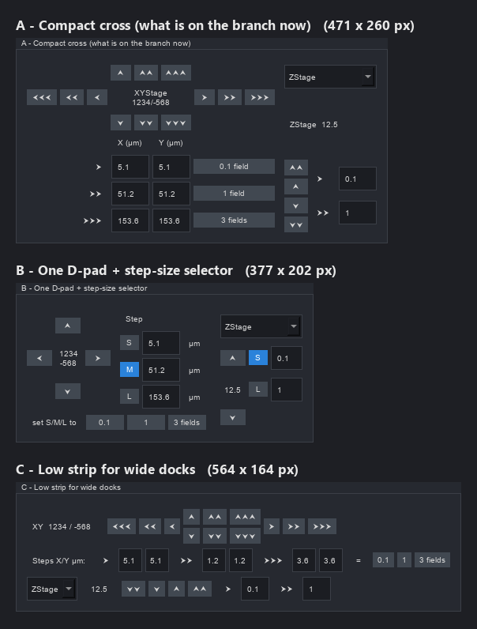

- Round 2 (D/E/F). The user liked F (ring dial), but found the Z capsule too round and wanted XY and Z less integrated:

  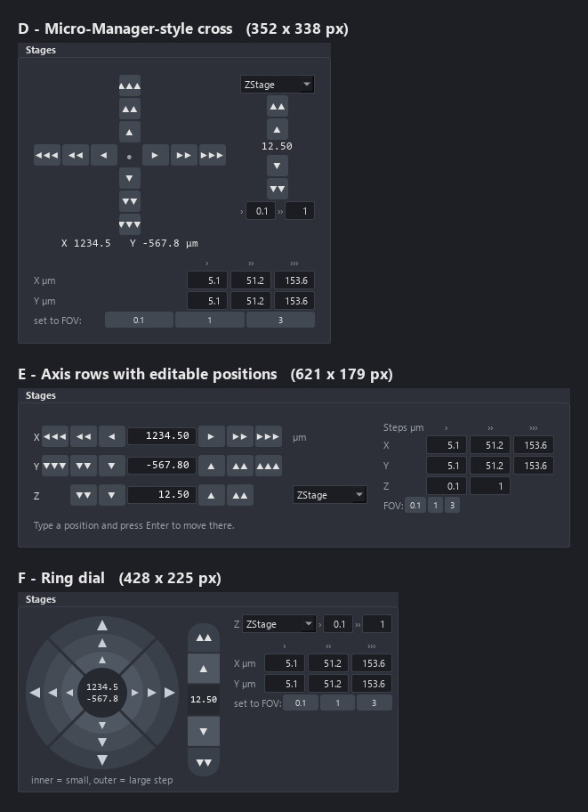

- Round 3: F2a and F2b. F2b was picked, with Z buttons sized like the XY ones, "(µm)" on the labels and µm on both Z steps:

  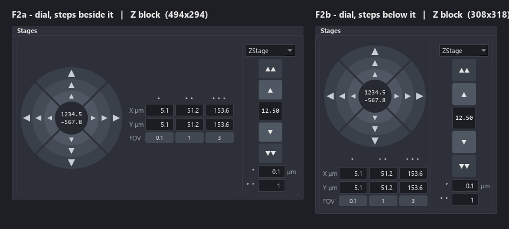

- Built version, rendered with napari's dark stylesheet after the user asked for narrower fields and less margin:

  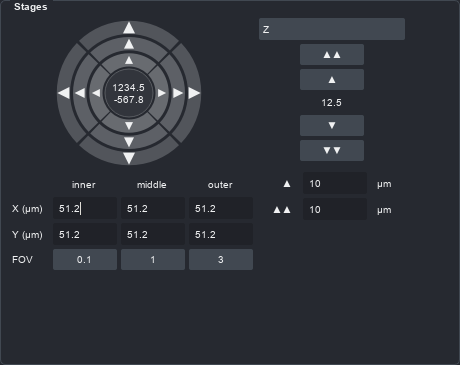

- Gotchas:
  - Under napari's QSS, a custom-painted widget's `Button`/`Base` palette roles stay light, so derive colours from `Window`/`WindowText`.
  - Offscreen without `QT_QPA_FONTDIR`, the font falls back and widths roughly double, so layout tests assert structure, not pixels.
  - The background size-debug pytest run hung and was stopped.

### Open items
- The dropdown fix has not been checked in the live app with real hardware.
- The auto-refresh still rebuilds the whole panel each interval; an open dropdown popup could be torn down mid-selection. This is pre-existing and was not addressed.
