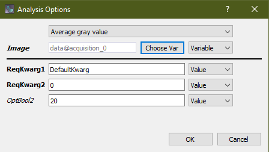
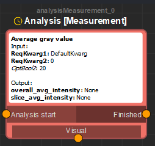
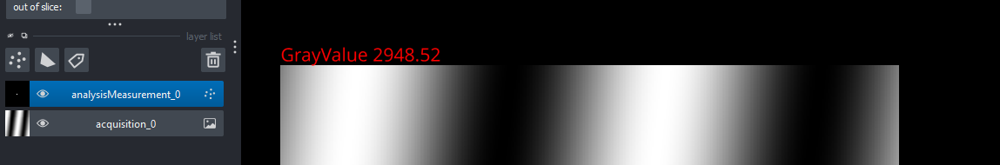
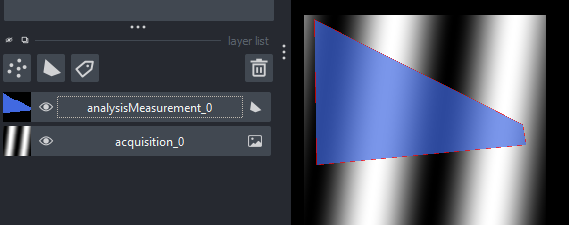
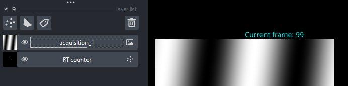

# Writing nodes

Glados' autonomous microscopy can be extended with your own nodes. This page describes how.

## Types of extensions

1. **Custom functions** are called by a recipe without an image input. Examples: iterative
   autofocus, stroboscopic laser modes, controlling a device that is connected to Python but not to
   Micro-Manager.
2. **Analysis functions** run after an acquisition has finished ("offline") and get the whole
   dataset. Examples: segmentation, an average image, counting fiducial markers. Their outputs
   become variables the rest of the recipe can use.
3. **Real-time analysis** runs on every frame during live mode or an acquisition. It gets only the
   current frame and its metadata, produces no variables, and can influence the running acquisition.
   Examples: laser adjustment, live localisation, stopping an acquisition early. Real-time analysis
   methods also appear in the *Real-time analysis* section of the Controls tab.

The *Run advanced script* node runs a few lines of Python inside the recipe; anything more than a
few lines is better written as a custom function.

## Where nodes live

| Type | Shipped with Glados | Your own nodes |
|------|---------------------|----------------|
| Analysis | `glados_pycromanager/AutonomousMicroscopy/Analysis_Measurements/` | `%LOCALAPPDATA%\Glados-PycroManager\AutonomousMicroscopy\Analysis_Measurements\` |
| Real-time analysis | `.../AutonomousMicroscopy/Real_Time_Analysis/` | `%LOCALAPPDATA%\Glados-PycroManager\AutonomousMicroscopy\Real_Time_Analysis\` |
| Custom function | `.../AutonomousMicroscopy/CustomFunctions/` | `%LOCALAPPDATA%\Glados-PycroManager\AutonomousMicroscopy\CustomFunctions\` |

Put your own nodes in the AppData folders: no change to the Glados source is needed, and an update
does not overwrite them. Every `.py` file in these folders is imported at startup.
*Plugins → Reload Glados Custom Nodes* re-imports them without restarting Glados (nodes already
placed in a recipe keep their old settings until re-opened).

## The structure of a node file

We use `Analysis_Measurements/AverageIntensity.py` as the example: it computes the average gray
value of an image stack. Its node dialog looks like this:



- a **display name**,
- a required **Image** input,
- two **required keyword arguments** (`ReqKwarg1`, `ReqKwarg2`) the user must fill in,
- one **optional keyword argument** (`OptBool2`),
- a tooltip with a description on each field.

All of that comes from the `__function_metadata__()` function in the file:

```python
from glados_pycromanager.lazy_imports import ndtiff
from glados_pycromanager.autonomous.registry import register

def __function_metadata__():
    return {
        "AvgGrayValue": {
            "input": [
                {"name": "Image", "type": [ndtiff.NDTiffDataset]}
            ],
            "output": [
                {"name": "overall_avg_intensity", "type": float, "importance": "Default"},
                {"name": "slice_avg_intensity", "type": [np.array]}
            ],
            "required_kwargs": [
                {"name": "ReqKwarg1", "description": "First required kwarg", "default": 'DefaultKwarg', "type": str},
                {"name": "ReqKwarg2", "description": "Second required kwarg", "default": 0, "type": int}
            ],
            "optional_kwargs": [
                {"name": "OptBool2", "description": "OptBool", "default": 20}
            ],
            "help_string": "Average gray value.",
            "display_name": "Average gray value",
            "visualisation_type": "value"  # 'image', 'points', 'value' or 'shapes'
        }
    }
```

- The key (`AvgGrayValue`) must be the name of a function (or, for real-time analysis, a class) in
  the same file.
- One file can hold several functions: add one key per function.
- Every **output** becomes a variable in the *Variables* tab.
- Each kwarg needs `name` and `default`. Give it a `description` and a `type` too: the type picks
  the widget (`bool` gets a checkbox, `'fileLoc'` a file picker) and real-time analysis kwargs are
  converted to it. See [Node parameters](rt-analysis-parameters.md) for how the
  Value/Variable/Advanced switch works.
- `help_string` and `display_name` are required. Analysis functions also need `visualisation_type`
  (see below).
- Use `glados_pycromanager.lazy_imports.ndtiff` rather than importing `ndtiff` directly, and import
  heavy libraries (torch, tensorflow, scipy.signal…) inside the function rather than at the top of
  the file: Glados imports every node file at startup, and `__function_metadata__()` is called then
  too.

### Registering the function

Every callable function (and real-time analysis class) must be registered under
`"<file name without .py>.<function name>"`, or the recipe cannot call it:

```python
@register("AverageIntensity.AvgGrayValue")
def AvgGrayValue(core, **kwargs):
    NDTIFFStack = kwargs['Image']
    import dask.array as da
    slice_avg_intensity = da.mean(NDTIFFStack.as_array(), axis=(1, 2))
    output = {}
    output['slice_avg_intensity'] = slice_avg_intensity.compute()
    output['overall_avg_intensity'] = slice_avg_intensity.mean().compute()
    return output
```

The function receives `core`, the core of the active backend (pycromanager's `Core` or
pymmcore-plus' `CMMCorePlus`), and the kwargs by name: `kwargs['Image']`, `kwargs['ReqKwarg1']`.
Analysis and custom-function kwargs arrive as strings, so convert them yourself
(`int(kwargs['ReqKwarg2'])`). It returns a dictionary with one entry per declared output.

Analysis functions run on a worker thread, which makes breakpoints hard to use. The
*DEBUG Analysis [Measurement]* node runs the same function on the main thread instead. Running
Glados from your IDE (`glados_pycromanager/GUI/GUI_napari.py`) makes debugging easiest.

## Custom functions

A custom function has no inputs, and its outputs are optional
(`CustomFunctions/ExampleCustomFunction_DiceRoll.py`):

```python
def __function_metadata__():
    return {
        "DiceRoll": {
            "input": [],
            "output": [
                {"name": "DiceResult", "type": [int], "importance": "Default"}
            ],
            "required_kwargs": [
                {"name": "MaxDiceValue", "description": "The largest value for a random value", "type": int, "default": 6}
            ],
            "help_string": "Example custom function",
            "display_name": "Example custom function - Roll a dice"
        }
    }

@register("ExampleCustomFunction_DiceRoll.DiceRoll")
def DiceRoll(core, **kwargs):
    diceRoll = np.random.randint(1, int(kwargs['MaxDiceValue']))
    return {"DiceResult": diceRoll}
```

Custom functions are mostly useful for changing microscope settings through `core`.

## Analysis functions

An analysis function usually takes the `Image` input and produces outputs for the rest of the
recipe. The Analysis node also has a **Visual** plug:



Connect a *Visualisation* node to it to show the result in napari. This is for the user only; the
recipe does not use it. Glados creates a napari layer whose type follows `visualisation_type`:
`'value'` or `'points'` a Points layer, `'image'` an Image layer, `'shapes'` a Shapes layer. Fill it
in a function with the same name plus `_visualise`, registered the same way:

```python
@register("AverageIntensity.AvgGrayValue_visualise")
def AvgGrayValue_visualise(datastruct, core, **kwargs):
    output, pointsLayer = datastruct   # the function's output dict, and the napari layer
    pointsLayer.data = [0, 0]
    pointsLayer.features = {'outputval': output['overall_avg_intensity']}
    pointsLayer.text = {'string': 'GrayValue {outputval:.2f}', 'size': 10, 'color': 'red',
                        'translation': np.array([0, 0]), 'anchor': 'upper_left'}
    pointsLayer.size = 0               # hide the point, keep the text
```



An image result (`AverageImage.py`):

```python
@register("AverageImage.AvgImage_visualise")
def AvgImage_visualise(datastruct, core, **kwargs):
    output, imageLayer = datastruct
    imageLayer.data = output['average_image']
    imageLayer.reset_contrast_limits()
```

Shapes (`RandomShapes.py`) work the same way, with `shapesLayer.data = [polygon]`:



## Real-time analysis

Real-time analysis builds on analysis functions; read those sections first. The example is
`Real_Time_Analysis/RT_counter.py`, which shows the current frame number.

Its metadata has a few extra fields:

```python
def __function_metadata__():
    return {
        "RealTimeCounter": {
            "required_kwargs": [
                {"name": "Color", "description": "Color of the text", "default": 'red', "type": str}
            ],
            "optional_kwargs": [],
            "help_string": "RT counter.",
            "display_name": "RT counter",
            "run_delay": 10,
            "visualise_delay": 50,
            "input": [],
            "output": [],
            "__runInSubprocess__": True,
            "__snapshot_attrs__": ["currentValue"],
            "__replayable__": True,
        }
    }
```

- `run_delay` and `visualise_delay` are the minimum time in milliseconds between two runs and two
  visualisations. They limit how much processing the method takes; frames that arrive while the
  method is busy are skipped.
- `__runInSubprocess__`: run `run()` in a separate process, so a slow analysis does not slow down
  the GUI or the acquisition. This is the default. In a subprocess `run()` gets `None` for `core`
  and `shared_data`.
- `__needsLiveCore__: True`: the method uses `core`, `shared_data` or the recipe in `run()` and must
  stay in the Glados process (for example `LaserAdjustment.py` and `EndAtFrame.py`). It overrides
  `__runInSubprocess__`.
- `__snapshot_attrs__`: the attributes `run()` sets that `visualise()` reads. They are copied with
  each frame so the overlay matches the frame it is drawn on, and so it survives the trip back from
  the subprocess. **An attribute not listed here does not reach `visualise()` from a subprocess.**
- `__replayable__`: whether Glados may store the results per frame and redraw them when you scroll
  through a finished acquisition. Set it to `False` when `visualise()` accumulates (such as a
  super-resolution image that grows frame by frame).

A real-time analysis is a class:

```python
@register("RT_counter.RealTimeCounter")
class RealTimeCounter:
    def __init__(self, core, **kwargs):
        self.currentValue = 0                     # once, when the analysis starts

    def run(self, image, metadata, shared_data, core, **kwargs):
        axes = metadata.get('Axes', {})           # every analysed frame
        self.currentValue = float(axes[list(axes)[-1]]) if axes else 0

    def end(self, core, **kwargs):
        pass                                      # once, when it stops

    def visualise_init(self):
        return 'RT counter', 'points'             # layer name and napari layer type

    def visualise(self, image, metadata, core, napariLayer, **kwargs):
        napariLayer.data = np.array([[0, 0]])     # every visualised frame
        napariLayer.properties = {'outputval': [self.currentValue]}
        napariLayer.text = {'string': 'Current frame: {outputval:.0f}', 'color': kwargs['Color']}
        napariLayer.size = 0
```

`run()` and `visualise()` are independent: drawing in napari is expensive, so it usually runs less
often than the analysis. Pass state between them through `self` (and list it in
`__snapshot_attrs__`). Real-time analysis kwargs arrive already converted to their declared type.



`visualise_init()` may also return a **list** of layers, as `(name, type)` pairs or dicts with
`name`, `type`, `colormap`, `blending`, `opacity`, `visible`, `scale` and `placement`
(`'overlay'`, `'right'` or `'below'`). `visualise()` then gets a group addressed by layer name,
`napariLayer['My node: render'].data = ...`. `pSMLM_live.py` is the full example: the analysed
frame, its localisations, and a super-resolution render placed to the right.

### Influencing the acquisition

`Real_Time_Analysis/EndAtFrame.py` stops an acquisition at a given frame. It declares
`__needsLiveCore__: True`, because it needs `shared_data`:

```python
def run(self, image, metadata, shared_data, core, **kwargs):
    if metadata['Axes']['time'] >= int(kwargs['LastFrame']):
        shared_data._mdaModeAcqData.abort()
        shared_data._mdaModeAcqData.mark_finished()
```
