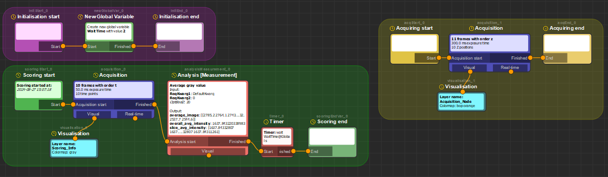

# Glados-pycromanager

Glados-pycromanager is a [napari](https://napari.org) interface for
[Micro-Manager](https://micro-manager.org), through
[Pycro-Manager](https://pycro-manager.readthedocs.io) and
[pymmcore-plus](https://pymmcore-plus.github.io/pymmcore-plus/). It has two goals:

1. a usable, user-friendly interface for controlling a Micro-Manager microscope from napari, and
2. easy, user-friendly **autonomous microscopy**: recipes that score each field of view and only
   acquire the ones that are good enough.

## Where to start

- **[Installation](installation.md)**: install Glados on Windows, connect it to Micro-Manager and start it.
- **[Controls](user-guide/controls.md)** and **[Multi-D acquisition](user-guide/mda.md)**: drive the microscope
  from napari.
- **[Autonomous microscopy](user-guide/autonomous.md)**: build and run recipes.
- **[Writing nodes](developer/writing-nodes.md)**: add your own analysis, real-time analysis or custom function.

Glados-pycromanager is a work in progress.

Created by Dr. Koen J.A. Martens (koenjamartens{at}gmail.com), 2023-2026.
Licensed under [CC BY-NC-SA 4.0](https://creativecommons.org/licenses/by-nc-sa/4.0/).
Please get in touch if you want to use or extend it.
