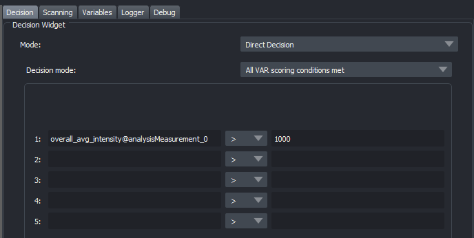
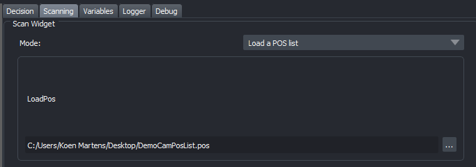
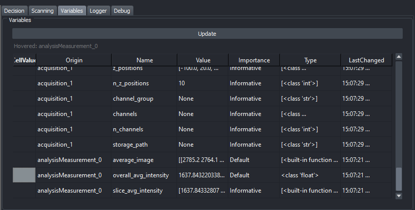

# Autonomous microscopy

## Concept

Autonomous microscopy evaluates each field of view with a method of your choice (**Scoring**), and
only if the field of view is good enough runs a more detailed acquisition on it (**Acquisition**).
For example: score each field of view by counting cells that are in focus, and only where there are
at least 20, record a long single-particle-tracking movie.

## Recipes

What happens is defined in a **recipe**: a graph of nodes, edited in the *Autonomous microscopy* tab.
A recipe has three sections:

- **Initialisation** (pink): runs once, at the start of a run.
- **Scoring** (green): runs for every field of view. It ends with a *Scoring end* node, after which
  the decision is taken whether the field of view is good enough.
- **Acquisition** (yellow): runs only for the fields of view that passed the decision.

Working with nodes:

- **Add** a node by right-clicking on the graph and choosing it.
- **Configure** a node by double-clicking it. The settings depend on the node.
- **Connect** nodes by dragging from a plug (output) to a socket (input). A node starts when its
  first incoming connection finishes; an *AND-Logic* node waits for all of them. Click a connection to
  remove it.

The available nodes:

| Group | Nodes |
|-------|-------|
| Section markers | Initialisation start/end, Scoring start, Scoring end, Early score end, Acquiring start/end |
| Microscope | Acquisition (a multi-D acquisition), Change Properties (configuration presets), Change Stage Position |
| Analysis | Analysis [Measurement], Real-Time analysis, Custom Function, Visualisation |
| Flow | Timer, If-statement, Case/Switch, AND-Logic, Run advanced script |
| Variables and output | New Global Variable, Change Global Variable, Store Data, Report, Slack Report, Sticky Note |

The analysis, real-time analysis and custom-function nodes are plugins: you can add your own
(see [Writing nodes](../developer/writing-nodes.md)).

## Decision and scanning

Next to the graph are the **Decision** and **Scanning** tabs.

- **Decision**: the criteria a field of view must meet for the acquisition to run. Use *Direct
  Decision* with *All VAR scoring conditions met*, and enter conditions on variables, for example
  "the average intensity measured during scoring is at least 1000".

    

- **Scanning**: the list of fields of view to score. Load a `.pos` position list, as saved by
  Micro-Manager's stage position list.

    

## Variables

The **Variables** tab lists every variable, in three groups:

- **Global** variables, which you create and change yourself with the *New/Change Global Variable*
  nodes: counters, storage locations, wait times.
- **Core** variables: the state of the microscope, such as the current preset of each configuration
  group or a stage position.
- **Node** variables: the outputs of nodes, such as an analysis result. Hovering over one highlights
  its node in the graph.

Click a variable to copy its exact name (e.g. `overall_avg_intensity@analysisMeasurement_0`) to the
clipboard, then paste it into a decision or a node setting. Node settings can be given as a fixed
**Value**, a **Variable**, or an **Advanced** expression built from variables.

The **Logger** and **Debug** tabs show the run's log messages.

## Testing and running

Test often while building a recipe:

- **Init Only** runs the Initialisation section. Nodes turn from yellow (waiting) to green
  (completed).
- **Scoring Only** runs the Scoring section once, without moving on to the acquisition whatever the
  decision.
- **Acquiring Only** runs the Acquisition section once.

**Start run** runs the whole recipe: initialisation, then for every position in the scanning list
scoring, the decision and, if it passes, the acquisition. **Interrupt run** stops it. A node that
fails turns red; its tooltip says why, and the run stops.

**Store graph** and **Load graph** save and load a recipe, together with its decision and scanning
settings. **Slack settings…** sets the Slack token and channel used by the *Slack Report* node.

## Example recipes

`glados_pycromanager/AutonomousMicroscopy/ExampleRecipes/` has four recipes, from simple to
complex. They are made for a simulated SMLM microscope (the `SMLMDemoCam` Micro-Manager device
adapter with its `DemoSMLM.cfg` configuration), together with the position list
`demo_zstage_3_planes.pos`:

1. `01_simple_timelapse.json`: set a sample, always pass scoring, record 100 frames of blinking
   dyes and show them in napari.
2. `02_intermediate_scoring_zstack.json`: scoring records 10 frames and passes only if the sample is
   bright enough; the acquisition is a z-stack with a live sharpness readout that peaks at the
   focal plane.
3. `03_complex_adaptive_branching.json`: a random sample by a dice roll (Case/Switch), a
   brightness gate, an If-statement that boosts the fluorophore when the sample is dim, an SMLM
   movie with live localisation, and a counter.
4. `04_fun_nuclear_pore_hunt.json`: nuclear pore complexes, rings ~107 nm wide, far below the
   diffraction limit. Watch the live super-resolution panel turn blobs into rings.

Each recipe has a *Sticky Note* explaining it. The brightness thresholds are starting points;
adjust them to your setup.
