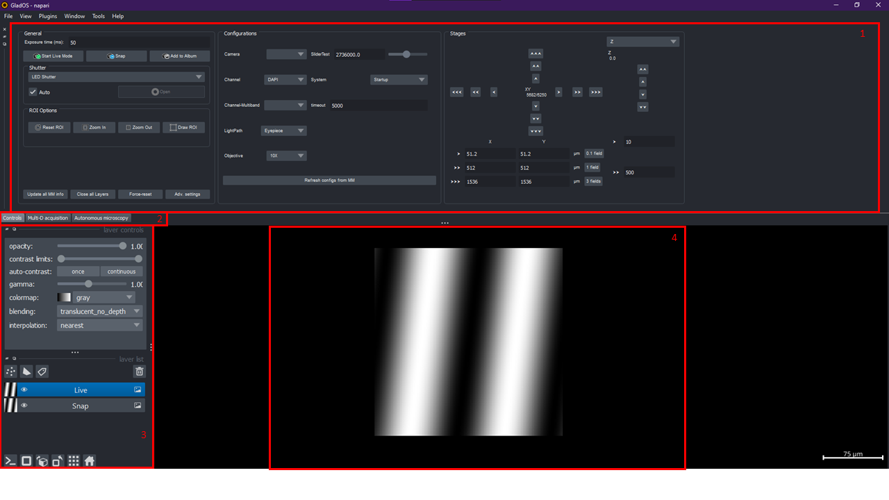

# Controls

After starting, the Glados window looks like this:

1. The Glados interface. It has three tabs (2).
2. The tabs: **Controls** (drive the microscope directly: live mode, configurations, stages),
   **Multi-D acquisition** (an acquisition like Micro-Manager's Multi-D acquisition) and
   **Autonomous microscopy** (recipes; see [Autonomous microscopy](autonomous.md)).
3. napari's layer list. Several layers can be open; their display settings are changed here.
4. napari's image viewer.

The sections of the Controls tab rearrange themselves when the dock is resized.

## General

- **Exposure time**, then **Start Live Mode**, **Snap** and **Add to Album**. Each creates a napari
  layer. These images are not saved; save one from napari with *File → Save Selected Layer(s)*.
  Changing the exposure during live mode restarts live mode with the new value.
- Five buttons along the bottom:
    - **Update all MM info**: re-reads every value from Micro-Manager. Depending on the setup this
      takes up to a few seconds, which is why it does not happen continuously.
    - **Close all Layers**: closes every napari layer.
    - **Force-reset**: tries to stop every running acquisition. Use it when Glados seems stuck.
    - **Adv. settings**: advanced settings, such as visualisation performance, live-mode method,
      the pymmcore-plus save format and the log level.
    - **Help**: links to this documentation (user guide, writing nodes, API reference).

## Shutter and ROI

- **Shutter**: choose a shutter and open or close it, as in Micro-Manager.
- **ROI Options**: **Reset ROI**, **Zoom In**, **Zoom Out** and **Draw ROI**. *Draw ROI* needs an
  image in the viewer (snap or live); draw a rectangle on it and it becomes the camera ROI. When live
  mode is running, Glados stops and restarts it around the ROI change.

## Configurations

Every Micro-Manager configuration group, one row each:

- a group with several presets is a dropdown of presets;
- a group with a single preset is edited through that property's own widget (a slider for a ranged
  property, otherwise a text field);
- a group whose properties are all read-only is shown as plain text.

Below the rows:

- **Refresh configs from MM** rebuilds the list, for example after the configuration changed in
  Micro-Manager.
- **Device Property Browser…** lists every property of every loaded device and lets you edit it.
- **Config Group Editor…** adds, edits, renames and deletes configuration groups and presets, in the
  same way as Micro-Manager's own group and preset editors. *Save* writes the configuration back to
  the `.cfg` file Glados was started with.

## Stages

- **XY stage**: the dial moves the stage in four directions; the inner ring is the smallest step and
  the outer ring the largest. Set the three step sizes in the table below it (the FOV buttons fill
  in one field of view).
- **Z stage**: pick the stage, then use the arrows; the step sizes are next to them. Scrolling the
  mouse wheel over the Z widget or over the image also moves the focus.
- **Relative stages**: any other one-axis stages.

## Real-time analysis

Pick an analysis method, set its parameters and press **Activate**. It runs on every frame of live
mode or an acquisition and draws its result as napari layers. Several methods can run at the same
time; a running method is highlighted in the dropdown. **Reset** restarts the selected method,
**Restore defaults** resets its parameters. Changed parameters are remembered between sessions.

Activating a method while nothing is acquiring analyses the image currently shown once.

## Scripts

An optional section (turn it on in *Adv. settings*) to run a Python script with access to the
microscope.
