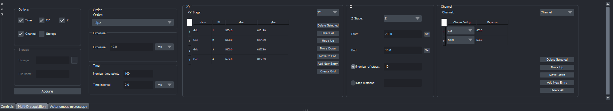

# Multi-D acquisition

The Multi-D acquisition tab covers and extends Micro-Manager's Multi-D acquisition:

- **Dimensions**: which of XY, Z, Channel, Time and Storage to use, and the **Order** in which the
  dimensions are run. For example `zt` goes to Z position 1, records all time points, moves to Z
  position 2, records all time points, and so on.
- **Exposure**: the exposure time, in milliseconds.
- **Time**: the number of time points and the interval (the minimum time between consecutive frames).
  With the pycromanager backends the interval does not combine with XY, Z or Channel, by
  pycromanager's design ([pycro-manager#733](https://github.com/micro-manager/pycro-manager/issues/733)).
- **XY**: a list of stage positions. As in Micro-Manager's position list you can build a grid;
  unlike it, the grid can be oriented in different ways.
- **Z**: a series of steps on one focus stage, set by start and end (**Set** takes the current
  position) and either the number of steps or the step size. **Wait for Z to settle** makes the
  camera wait until the stage has stopped before each burst; leave it off when an external trigger
  drives the camera, so no trigger pulse falls in the gap (not available with the Java backend).
- **Channel**: several channels, each with its own exposure time.
- **Storage**: the folder and file name. Without Storage the acquisition is kept only temporarily and
  deleted afterwards. With the PyMMCorePlus backend the file format is set in *Adv. settings*
  (NDTiff by default, or OME-TIFF / OME-Zarr).

**Acquire** runs the acquisition and shows it in napari as it comes in.
